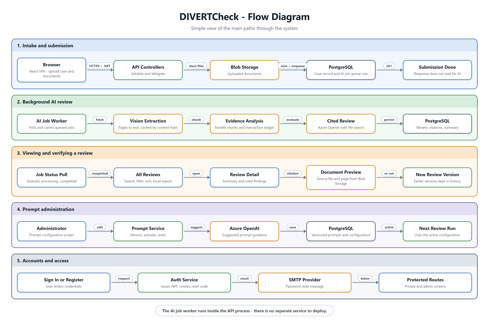

# DIVERTCheck™
### Diversion Intake, Verification & Eligibility Review Tool Check

> *Copyright © 2026 American Arbitration Association, Inc. All rights reserved.
DIVERTCheck™ is the trademark of American Arbitration Association, Inc.
See [LICENSE.md](LICENSE.md) for terms.*


DIVERTCheck is an AI-assisted intake and document-review application. It reviews uploaded case materials — complaints, contracts, supporting evidence — against the eligibility criteria for a diversion program, and returns a cited review that a person can verify and act on.

This README is the front door for the repository. It explains the application, its workflow, and the commands you run day to day. Setup lives in [SETUP.md](docs/SETUP.md) and the system design in [ARCHITECTURE.md](docs/ARCHITECTURE.md).

## Start Here

**New to the repository?** Read the [architecture diagram](docs/ARCHITECTURE.md) first, then follow [SETUP.md](docs/SETUP.md) end to end. Everything else below is reference.

| I want to… | Go to |
| --- | --- |
|See the User Guide | [DIVERTCheck User Guide](DIVERTCheck_User_Guide.docx) 
| See how the system fits together | [ARCHITECTURE.md](docs/ARCHITECTURE.md) — diagram, request and review paths, conventions |
| See the main paths through the system | [Flow Diagram](docs/diagrams/app_flow.png) — intake, AI review, verification, prompts, accounts |
| Set up the app | [SETUP.md](docs/SETUP.md) — prerequisites, Azure access, first run, troubleshooting |
| Understand hosting options | [HOSTING.md](docs/HOSTING.md) — OCA server and other deployment options |
| Install and run it now | [Run It](#run-it) — the commands, below |
| Know where code lives | [Repository Map](#repository-map), or the table in [ARCHITECTURE.md](docs/ARCHITECTURE.md#where-things-live) |
| Understand configuration files | [Configuration Files](docs/SETUP.md#configuration-files) — what each `appsettings` and `.env` file controls |
| Find an environment variable | [Frontend Environment Variables](docs/SETUP.md#frontend-environment-variables) |
| Find a Key Vault secret name | [Azure Key Vault values](docs/SETUP.md#azure-key-vault-values) — secret-name-to-config-key table |
| Browse or test the API | [Swagger](http://localhost:5175/swagger), once the API is running; see [Swagger Authorization](docs/SETUP.md#swagger-authorization) for JWT setup |
| Know why the product exists | [Purpose](#purpose) — what it decides and what it leaves to a person |
| Know what the product does | [What the App Does](#what-the-app-does) and [How It Works](#how-it-works) |
| Give someone administrator access | [Roles and Access](#roles-and-access) — new accounts are `USER`; promotion is a database change |

## Run It

You need the .NET 10 SDK, Node.js, and Azure CLI sign-in (`az login`) for Key Vault access. First time on this machine? Use [SETUP.md](docs/SETUP.md) instead — the API will not start without Azure access and database credentials.

### API

From the repository root:

```powershell
dotnet restore api/DIVERTCheck.csproj
dotnet run --project api/DIVERTCheck.csproj
```

- `http://localhost:5175` (Swagger at `http://localhost:5175/swagger`)
- `https://localhost:7273`

To call protected endpoints in Swagger, sign in with `POST /api/v1/Auth/login`, copy the `accessToken` from the response, select **Authorize** at the top of Swagger, and enter `Bearer <accessToken>`. See [Swagger authorization](docs/SETUP.md#swagger-authorization) for the full steps.

To run against staging configuration ([`api/appsettings.Staging.json`](api/appsettings.Staging.json)):

```powershell
$env:ASPNETCORE_ENVIRONMENT="Staging"
dotnet run --project api/DIVERTCheck.csproj
```

### Frontend

From the `frontend` directory:

```powershell
npm install
npm run dev          # http://localhost:5174
npm run dev:uat      # same port, staging settings from frontend/.env.staging
```

### Checks

```powershell
npm run build
npm run build:staging
npm run lint
```

## Purpose

DIVERTCheck determines whether a court case appears to meet the eligibility criteria for a court’s caseload diversion program.

A user uploads the necessary case materials. The application reads them, evaluates them against the eligibility criteria defined in the active prompt configuration, and returns a cited review stating which criteria are met, which are not, and the evidence behind each finding — work that otherwise means reading every document by hand.

Two things this is not:

- **Not a decision.** The output is a recommendation with its supporting evidence. A person makes the eligibility determination.
- **Not a fixed rulebook.** The criteria live in the prompt configuration, which administrators version and activate, so they change without a code release.

## What the App Does

- Creates intake reviews with a case name, case number, optional filing date, and one or more uploaded documents.
- Lets users identify which party submitted each document and mark documents that contain transaction evidence.
- Stores uploaded files in Azure Blob Storage and protects application access with JWT authentication.
- Using customizable prompts, it builds a detailed, cited AI eligibility review and a concise summary from the selected documents.
- Queues AI review work in the background so document analysis does not block the intake submission.
- Extracts document content, including vision-based extraction where needed, then analyzes the evidence in chunks for the configured eligibility criteria.
- Gives users a review queue with search, filtering, sorting, pagination, and Excel export.
- Lets users view source documents and review citations alongside the AI result.
- Preserves review history so users can return to an earlier review version after a document set is updated and re-reviewed.
- Let's authorized administrators manage, version, activate, and undo the AI prompt configuration, including AI-suggested prompt guidance from preprogrammed references or a reference document, such as a court order or other document outlining the parameters of the diversion program.
- Supports registration, sign-in, password reset, health checks, API documentation, application logging, and Azure Monitor telemetry.
Note: The Sample Prompts are part of the INSERT SQL Script under [Insert Prompts Data](/api/SQLScripts/INSERT_PROMPTS/INSERT_Eligibility_and_Summary_Prompt.sql)

## How It Works



1. A user starts a new review, enters the case details, and uploads the intake documents.
2. Before submission, the user reviews the upload list, identifies the submitting party for each file, and marks any transaction-evidence documents.
3. Selecting **Run Review** creates the case, saves the documents, and places an AI job on the background queue.
4. The AI extracts and organizes information from the documents, evaluates it using the active prompt configuration, and produces a cited detailed review plus a summary.
5. The review appears in **All Reviews** when processing completes. The user can inspect the source files, citations, and result; update the document set; and run a new review when needed.

**AI assists with extraction and analysis, but it does not replace user judgment. Users retain the opportunity and responsibility to inspect the analysis and source material and verify or correct the information before relying on the result. The user makes the final determination.**

## Roles and Access

A newly registered account is always a **`USER`**. The registration screen does not offer a role, and [AuthService](api/Services/AuthService.cs) falls back to the `USER` role.

Granting administrator access is a **database change**. A database administrator updates the account's role in the `users` table:

```sql
UPDATE users
SET role_code = 'ADMIN'
WHERE email = 'person@example.com';
```

- `role_ind_code` stays `USER_ROLE` — it is the code type, not the role.
- `role_code` must be a value that already exists in `code_values` for code type `USER_ROLE`, or sign-in will fail validation.
- The role travels in the JWT, so the user must **sign out and sign back in** before the change takes effect.

Administrators see the prompt-administration screens — versioning, activating, and undoing the AI prompt configuration. Everything else is available to any signed-in user.

## Current Stack

- .NET 10 and ASP.NET Core Web API
- React 19, TypeScript, Vite, Tailwind CSS, and React Router
- Entity Framework Core and PostgreSQL
- Azure OpenAI
- Azure Blob Storage and Azure Key Vault
- Azure Monitor / Application Insights and OpenTelemetry
- JWT bearer authentication and SMTP email
- NLog, Swagger, and Docnet

## Repository Map

- `api/Program.cs`: API startup, configuration, dependency injection, authentication, CORS, telemetry, and health checks
- `api/Controllers/`: HTTP endpoints for authentication, cases, documents, AI jobs, reviews, and prompt configuration
- `api/Services/`: case and document services, Blob Storage, AI execution, background queue processing, review assembly, and email services
- `api/Data/`: Entity Framework repositories
- `api/Models/`: database entities and EF Core context
- `api/ViewModel/`: API request and response models
- `api/appsettings*.json`: shared, development, and staging configuration
- `frontend/src/pages/`: intake upload, review queue, review detail, document preview, authentication, and prompt-administration screens
- `frontend/src/services/`: API clients and frontend data access
- `frontend/src/components/`: shared UI and layout components

## Configuration and Secrets

- The API reads from `api/appsettings.json` and environment-specific settings from `api/appsettings.Development.json` and `api/appsettings.Staging.json`.
- Loads sensitive values from Azure Key Vault, which takes precedence. 
- The frontend reads `VITE_API_BASE_URL` from its `.env` files.

[SETUP.md](docs/SETUP.md) has the details: [what each configuration file controls](docs/SETUP.md#configuration-files), the [Key Vault secret names and the config keys they map to](docs/SETUP.md#azure-key-vault-values), and the [frontend environment variables](docs/SETUP.md#frontend-environment-variables).

Do not commit real values for:

- Database connection strings
- Azure Storage connection strings
- Azure OpenAI API keys or endpoints
- Azure Key Vault credentials
- Azure Monitor connection strings
- SMTP passwords
- Local publish profiles or other machine-specific settings

## Operational Notes

- AI reviews are asynchronous. The frontend tracks job status and displays queued, processing, completed, cancelled, or failed work in the review workflow.
- `GET /health` is anonymous for service health monitoring; other API endpoints require authentication unless explicitly configured otherwise.
