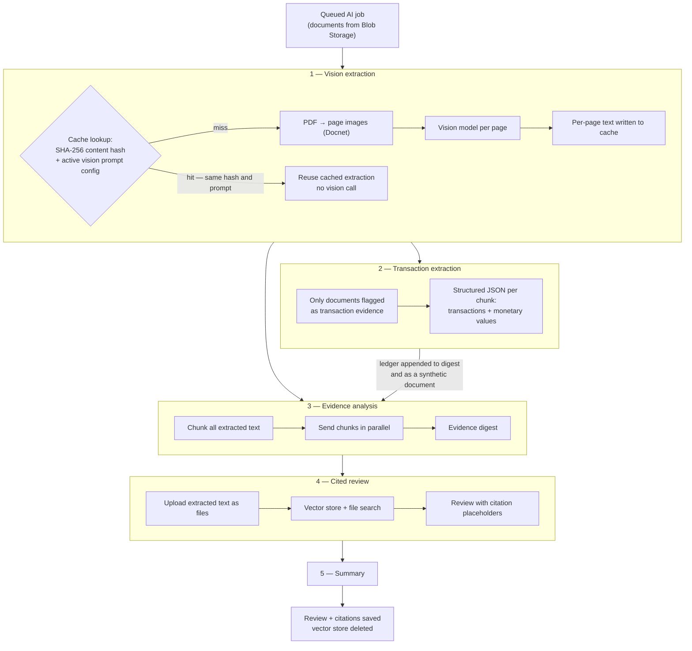

# DIVERTCheck - AI Flow

What happens between "Run Review" and a finished, cited review — and how to watch it happen in Azure AI Foundry.

See [ARCHITECTURE.md](ARCHITECTURE.md) for how the API, worker, and Azure services fit together, and [SETUP.md](SETUP.md) for configuration.

- [The pipeline at a glance](#the-pipeline-at-a-glance)
- [Stage 1 — Vision extraction](#stage-1--vision-extraction)
- [Stage 2 — Transaction extraction and the financial total](#stage-2--transaction-extraction-and-the-financial-total)
- [Stage 3 — Chunking and evidence analysis](#stage-3--chunking-and-evidence-analysis)
- [Stage 4 — The cited review](#stage-4--the-cited-review)
- [Stage 5 — The summary](#stage-5--the-summary)
- [Prompts](#prompts)
- [Tuning knobs](#tuning-knobs)
- [Tracing in Azure AI Foundry](#tracing-in-azure-ai-foundry)

## The pipeline at a glance

Everything below runs inside `ExecuteCaseReviewAsync` in [api/Services/OpenAiExecutionService.cs](../api/Services/OpenAiExecutionService.cs), called by the background worker after a review is queued.



Stages 1–4 are checkpointed per job. If the final review step fails and is retried, `RetryExecutionState` replays the finished extraction, ledger, digest, and vector store rather than paying for them twice.

## Stage 1 — Vision extraction

[api/Services/PromptVisionExtractionService.cs](../api/Services/PromptVisionExtractionService.cs)

Case documents arrive as PDFs, images, and plain text. Rather than parsing PDF text layers — which are missing from scans and unreliable in exports — every non-text page is **rendered to an image and read by a vision model**. That handles scans, photographs, stamps, handwriting, and table layouts through one path, and it means a statement renders the same way whether it came from a bank's PDF export or a phone photo of a printout.

How a document moves through it:

1. **Plain text short-circuits.** Text files are read directly and returned as a single page. No model call.
2. **Cache lookup.** The file content is hashed with SHA-256. The cache key is *content hash + active vision prompt configuration*, not document id, so re-uploading the same file — or a different case uploading an identical one — reuses the earlier extraction. Changing the vision prompt invalidates the cache naturally, because the prompt configuration is part of the key. Extractions are cached in Blob Storage.
3. **PDF → page images.** Docnet renders each page at 2200×3000. Transparent pixels are flattened onto white (`FlattenTransparencyOntoWhite`) so that transparency does not reach the model as black, and each page is encoded as PNG.
4. **One model call per page**, against the chat completions endpoint, sending the page image plus the active `Vision` prompt. Pages are dispatched in batches of `DocumentProcessing:MaxParallelVisionCalls`.
5. **Retry.** Each page retries up to `DocumentProcessing:VisionRetryCount` times with a short escalating delay. Two failures are not retried: cancellation, and a truncated response (`VisionResponseTruncatedException`) — a truncated page means the output token budget was too small, and retrying it unchanged would just truncate again.
6. **Pages are reassembled in order** and written to the cache.

The output is one text block per page, with one-based page numbers preserved. Those page numbers are load-bearing: every later stage cites them, and the transaction extractor validates against them.

Images are single-page by definition. Anything that is not text, image, or PDF is rejected with `NotSupportedException`.

## Stage 2 — Transaction extraction and the financial total

This stage only runs for documents the user marked as **transaction evidence** at upload time. If no document is flagged, it is skipped entirely and the review proceeds without a ledger.

The goal is a defensible total of purchase transactions — one that a person can audit line by line.

**The model extracts; it does not calculate.** Each chunk of transaction-evidence text is sent to the model with the active `Transaction` prompt and a structured output schema, and it returns two lists:

- **Transactions** — date, description, amount, source page. These are the line items that count toward the total.
- **Monetary values** — labelled amounts observed on the page (a printed "Total", a balance, a fee) with their source page. These are recorded as *observed*, not summed.

Keeping those two lists separate is the point. A printed total on a statement is evidence of what the document claims; it is not a line item, and adding it to the line items would double-count.

Every returned item is then checked in C# before it is trusted:

- **Page bounds.** A transaction or monetary value whose `SourcePage` falls outside the chunk's own page range fails the whole run. A citation that cannot be traced back to a real page is worse than no citation.
- **Amount parsing.** Amounts are stripped of `$` and thousands separators and parsed as `decimal`. A value that will not parse fails the run — it is never coerced to zero or skipped silently.
- **Deduplication.** Chunks overlap by design (see stage 3), so the same transaction can be extracted twice. Transactions are deduplicated on the tuple *(source document, source page, date, description, amount)*; monetary values on *(source document, source page, label, amount)*.
- **The sum.** The total is `transactions.Sum(...)` over parsed `decimal` values, computed in C#. The model never adds anything up, so the total cannot drift with sampling and is reproducible from the ledger.

The result feeds forward three ways: as a synthetic `statement-ledger.txt` document the review can search and cite, as a block appended to the evidence digest, and as a rendered ledger section appended to the final review Markdown.

## Stage 3 — Chunking and evidence analysis

[api/Services/DocumentChunkingService.cs](../api/Services/DocumentChunkingService.cs)

All extracted text — every document, not just transaction evidence — is split into chunks of `DocumentProcessing:EvidenceChunkMaxCharacters` with `DocumentProcessing:ChunkOverlap` characters of overlap. The overlap keeps a fact that straddles a boundary from being lost by both neighbours; the cost is the duplication that stage 2 deduplicates.

Chunks are analyzed in parallel, bounded by a semaphore at `DocumentProcessing:MaxParallelEvidenceCalls`, each with its own retry budget (`EvidenceRetryCount`). The per-chunk analyses are folded into an **evidence digest**: a single cross-document map of what was found and where, which the final review uses as its authoritative source rather than re-reading every chunk. If the digest is marked `INCOMPLETE`, the review is instructed to say so rather than present partial findings as complete.

## Stage 4 — The cited review

Each extracted text file — plus the synthetic ledger, when there is one — is uploaded to the AI service, added to a **vector store**, and the store is polled until it is ready. The review call gets the digest inline and the vector store for file search, so it can go back to the source text for anything the digest summarizes.

Citations are not free text. The model returns structured output containing the review Markdown plus a citations array, and the Markdown carries `<<citation:N>>` placeholders that the platform resolves afterward. Each citation must name a `source_document_id` from the supplied document list and a one-based page number from that document. The model is explicitly forbidden from writing its own Markdown links, so every visible citation traces to a document and page the system can verify. Where nothing supports a claim, the required text is `Not found in the provided documents.` with no citation — an unsupported statement has to be visibly unsupported rather than quietly plausible.

Coverage is validated after rendering (`ValidateCitationCoverage`), and `AzureOpenAI:CaseReviewCitationCorrectionAttempts` bounds how many correction passes a citation problem gets.

The vector store and its uploaded files are **deleted when the run completes**, in a `finally` block. They are working state, not storage.

## Stage 5 — The summary

The finished detailed review — ledger section included — is sent back with the Summary Prompt to produce the short summary shown in the review queue. It is capped by `AzureOpenAI:CaseReviewSummaryMaxOutputTokens`, and it summarizes the review rather than re-reading the documents, so it cannot introduce a claim the cited review does not make.

## Prompts

Prompts live in the database, not in code. Each one is a row in the `prompt` table, and a prompt configuration (`prompt_configuration`) pins a prompt version, a model name, a reasoning effort, and a max output token budget.

Only the case-review **Eligibility Prompt** and **Summary Prompt** are managed through the UI, on the Prompts screen. Saving there creates a new version rather than overwriting the old one. `INSERT.sql` seeds a sample Eligibility Prompt and Summary Prompt so a new installation has a working starting point to edit.

Four prompts are seeded by `INSERT.sql` and have **no screen in the application**: Vision extraction, Transaction extraction, Eligibility prompt generation, and Summary prompt generation. They are edited directly in the `prompt` table. See [System prompts live in the database](SETUP.md#system-prompts-live-in-the-database) for how each one is resolved and how to change it safely.

| Prompt | `prompt_type` | Managed in | Used for |
| --- | --- | --- | --- |
| Vision extraction | `Vision` | `prompt` table | Per-page OCR and layout reading in stage 1 |
| Transaction extraction | `Transaction` | `prompt` table | Structured transaction and monetary-value extraction in stage 2 |
| Eligibility Prompt | `Eligibility` (`main_prompt_text`) | Prompts screen | The detailed review criteria in stage 4 |
| Summary Prompt | `Eligibility` (`summary_prompt_text`) | Prompts screen | The summary in stage 5 |
| Eligibility / Summary prompt generation | `Suggested` | `prompt` table | Generating suggested Eligibility and Summary prompts on the Prompts screen |

Stage 1 and stage 2 each resolve their own active prompt independently and throw if none is configured — a deployment with no active `Vision` or `Transaction` prompt fails loudly at the start of a run rather than silently skipping a stage.

## Tuning knobs

All in `api/appsettings.json`; see [SETUP.md](SETUP.md#configuration-files).

| Key | Effect |
| --- | --- |
| `AzureOpenAI:DefaultModelName` | Model used when a prompt configuration does not name one |
| `AzureOpenAI:DefaultReasoningEffort` | Default reasoning effort |
| `AzureOpenAI:VisionExtractionMaxCompletionTokens` | Per-page vision output budget — too low causes truncation failures on dense pages |
| `AzureOpenAI:CaseReviewMaxOutputTokens` | Output budget for the detailed review |
| `AzureOpenAI:CaseReviewSummaryMaxOutputTokens` | Output budget for the summary |
| `AzureOpenAI:CaseReviewCitationCorrectionAttempts` | How many citation correction passes are allowed |
| `DocumentProcessing:MaxParallelVisionCalls` | Vision pages in flight at once — the main throughput/rate-limit tradeoff |
| `DocumentProcessing:VisionRetryCount` | Retries per page |
| `DocumentProcessing:EvidenceChunkMaxCharacters` | Chunk size |
| `DocumentProcessing:ChunkOverlap` | Overlap between chunks |
| `DocumentProcessing:MaxParallelEvidenceCalls` | Concurrent chunk analyses |
| `DocumentProcessing:EvidenceRetryCount` | Retries per chunk |
| `DocumentProcessing:EvidenceMaxOutputTokens` | Output budget per chunk analysis |
| `AiJobProcessing:JobTimeoutSeconds` | Wall-clock limit for one review job |
| `AiJobProcessing:StaleProcessingTimeoutSeconds` | When a claimed job is considered abandoned and requeued |

If you hit rate limits, lower `MaxParallelVisionCalls` and `MaxParallelEvidenceCalls` before anything else — they control nearly all of the concurrency.

## Tracing in Azure AI Foundry

Every AI step emits an OpenTelemetry span. The API creates them on an `ActivitySource` (`OpenAiExecutionService.ActivitySourceName`), registered in [api/Program.cs](../api/Program.cs) and exported by the Azure Monitor distro to the Application Insights resource named in `AzureMonitor:ConnectionString`.

### What to look for

| Span | Emitted when |
| --- | --- |
| `case_review.execute` | Root span for one review — tags the prompt configuration, version, and document count |
| `openai.vision` | One per page image sent to the vision model |
| `workflow.calculate_purchase_total` | The financial calculation — the whole audit trail is on this span |
| `openai.responses` | Any model call carrying prompt context (transaction extraction, chunk analysis, review, summary) |
| `openai.files.upload` | Extracted text file uploaded |
| `openai.vector_store.create` / `.file.add` / `.status` | Vector store setup and readiness polling |
| `suggested_prompt.generate` | Administrator-triggered prompt suggestion, outside the review flow |

### Seeing prompts and responses

Prompt and response text is **off by default**. Turn it on with:

```json
"AzureMonitor": {
  "TraceOpenAIPayloads": true,
  "TracePayloadMaxChars": 8000
}
```
### Querying it directly

The Foundry and Application Insights UIs are the easy path; Logs (KQL) is the precise one. Spans land in `dependencies`, span events in `traces`, correlated by `operation_Id`.

One review, start to finish:

```kusto
dependencies
| where name startswith "case_review" or name startswith "openai" or name startswith "workflow"
| where operation_Id == "<operation id>"
| project timestamp, name, duration, success, customDimensions
| order by timestamp asc
```

Slowest vision pages:

```kusto
dependencies
| where name == "openai.vision"
| top 20 by duration desc
| project timestamp, duration,
    file = tostring(customDimensions["document.file_name"]),
    bytes = tostring(customDimensions["vision.image_size_bytes"])
```
