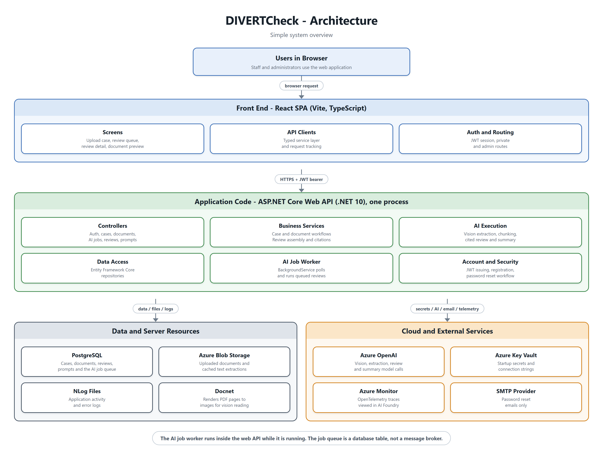
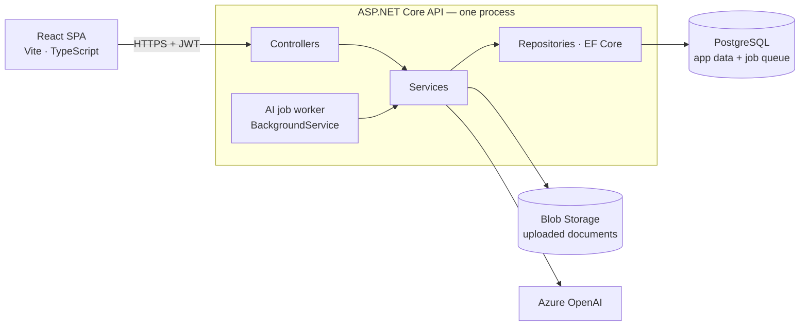
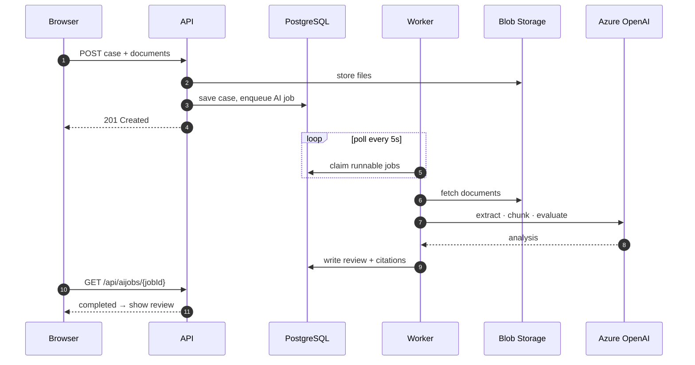

# DIVERTCheck - Architecture

A short map of how DIVERTCheck fits together. See the [README](../README.md) for what the app does and how to run it, and [SETUP.md](SETUP.md) to get it running on a new machine.

## Components

The same picture as a diagram-as-code source, for editing:

- The API and the AI worker are the **same process**. There is no separate service to deploy.
- The job queue is a **PostgreSQL table**, not a message broker.
- Key Vault (secrets) and Azure Monitor (telemetry) wire in at startup in [Program.cs](../api/Program.cs) and are not on any request path.
- A path-by-path view of the same system — intake, AI review, verification, prompt administration, accounts — is in the [flow diagram](diagrams/app_flow.png).

## Request path

A normal API call, front to back:

1. React calls the API over HTTPS with a JWT bearer token.
2. A controller validates the request and delegates — no logic lives here.
3. A service applies the business rules and calls Blob Storage if files are involved.
4. A repository reads or writes PostgreSQL through EF Core.

## Review path

Submitting an intake returns straight away; the AI work happens behind the queue.

What each stage does:

- **Enqueue** — the case, its documents, and a row in `AiJobQueue`; the response does not wait for AI.
- **Claim** — [AiJobQueueHostedService](../api/Services/AiJobQueueHostedService.cs) polls every 5s and fans jobs out to a bounded number of workers, so one slow job does not block the rest.
- **Extract** — document text, plus vision extraction where a document needs it.
- **Evaluate** — chunked content scored against the active prompt configuration.
- **Persist** — a cited detailed review and a summary.

## Where things live

| Area | Path |
| --- | --- |
| Startup, DI, auth, CORS, telemetry | [api/Program.cs](../api/Program.cs) |
| HTTP endpoints | [api/Controllers/](../api/Controllers/) |
| Business logic and integrations | [api/Services/](../api/Services/) |
| Background worker | [api/Services/AiJobQueueHostedService.cs](../api/Services/AiJobQueueHostedService.cs) |
| Data access | [api/Data/](../api/Data/) |
| Entities and `DbContext` | [api/Models/](../api/Models/) |
| Request/response models | [api/ViewModel/](../api/ViewModel/) |
| Screens | [frontend/src/pages/](../frontend/src/pages/) |
| API clients | [frontend/src/services/](../frontend/src/services/) |

## Conventions worth knowing

- Controllers validate and delegate. Logic belongs in a service.
- Services are registered against interfaces in `api/Services/Interfaces` and resolved by DI in `Program.cs`. Most are scoped; `AiCancellationService` and `PasswordResetCodeService` are singletons because they hold in-memory state.
- The background worker resolves scoped services through `IServiceScopeFactory` — it cannot inject them directly.
- Secrets come from Key Vault in deployed environments and from `appsettings.*.json` locally. Never commit real values.
- Every endpoint requires authentication except `GET /health`.
